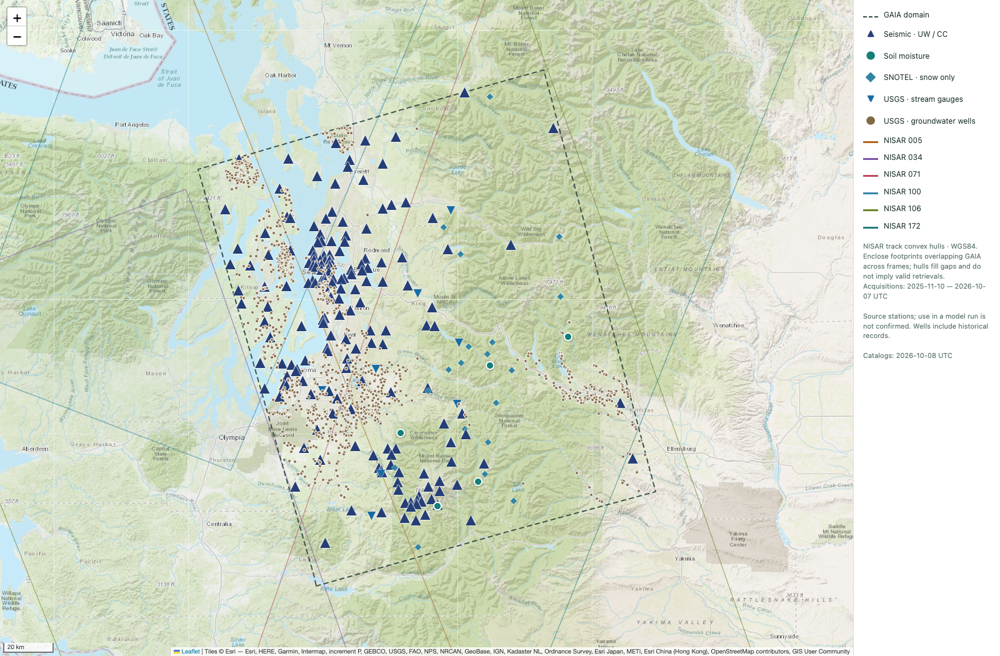
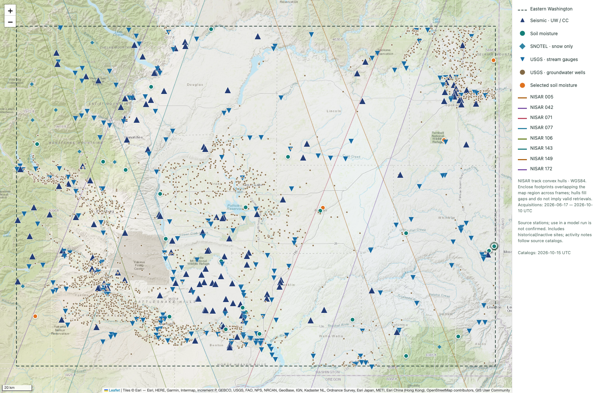
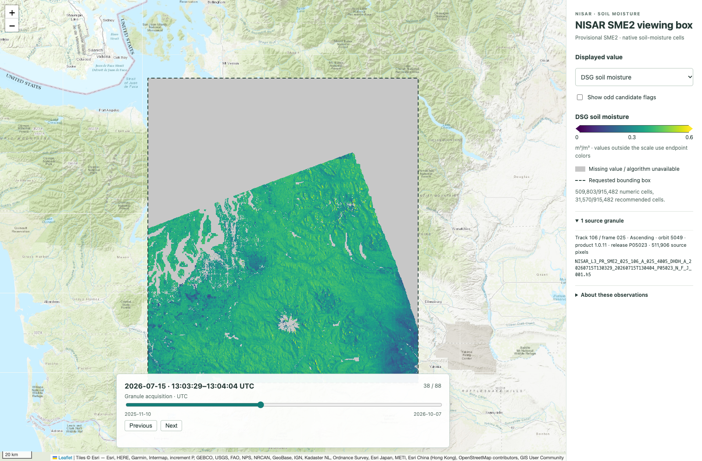
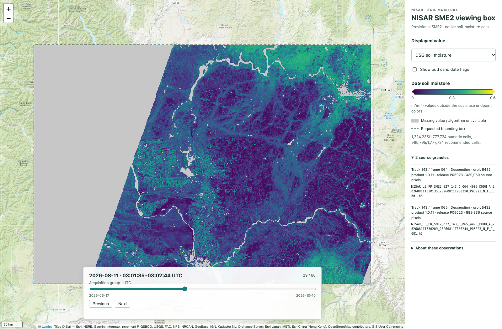
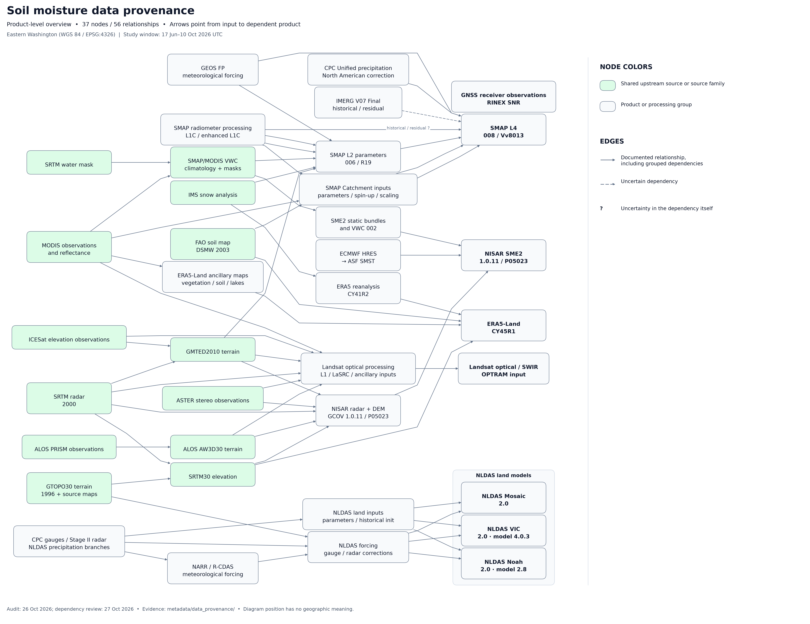

# soil-moisture-fusion

## Goal

We want to integrate [NISAR SME2](https://nisar-docs.asf.alaska.edu/sme2/) soil moisture observations and their uncertainties into [GAIA's soil-state model](https://github.com/gaia-hazlab/gwl-space-time-smooth), and evaluate the added accuracy and uncertainty calibration.
Ultimately, we want to contribute methodology for multi-modal data fusion that generalizes to arbitrary temporal and spatial resolution, propagating uncertainty accordingly.  

## Milestones

0. Literature review.
    - See [related_work.md](docs/references/related_work.md)
1. Identify data sources, observation period, observation area and target spatial and temporal resolutions for the pilot.
    - See [Eastern Washington data dependencies](docs/regridding/data.md) and [SME2 coverage and quality](docs/nisar/sme2.md).
    - Target spatial / temporal resolution: 90m / 1 day
2. Produce gridded NISAR SME2 observations (surface soil-moisture estimate with uncertainty) for the pilot region at the target spatiotemporal resolution. 
    - Gridded data should be compatible with the soil-state model's data representation. 
    - Uncertainty estimation should combine SME2's provided uncertainty layers with compounding effects introduced by spatiotemporal gridding.
    - Must design validaton criteria to assess the uncertainty calibration.
3. Relate NISAR SME2 surface observations to the soil-state model's root zone target. Requires designing and validating an explicit depth conversion with uncertainty propagation. 
4. Compare the soil-state model with and without NISAR SME2, assessing estimation error and interval coverage. 

## Evaluation targets

| Target | Evaluation focus |
|---|---|
| SME2 retrieval uncertainty | Whether reported surface-moisture uncertainty describes retrieval errors at the original observation footprint and time. |
| SME2 spatiotemporal gridding uncertainty | Whether uncertainty after aggregation, resampling, interpolation or gap filling accounts for changes in spatial and temporal support, including correlated errors. |
| Surface-to-root-zone mapping uncertainty | Whether uncertainty propagated through the depth relationship accounts for mapping errors and uncertain parameters. |
| Impact of NISAR integration | Whether GAIA with NISAR improves estimation accuracy and uncertainty calibration relative to GAIA without NISAR. |

## Environment setup

```
pixi shell
```

## Interactive Data Exploration

### Station and NISAR footprint maps

| Western Washington (GAIA domain) | Eastern Washington |
| --- | --- |
| [](https://meganfrisella.github.io/soil-moisture-fusion/stations/western_washington/) | [](https://meganfrisella.github.io/soil-moisture-fusion/stations/eastern_washington/) |

### NISAR SME2 maps

| Western Washington (GAIA domain) | Eastern Washington |
| --- | --- |
| [](https://meganfrisella.github.io/soil-moisture-fusion/sme2/western_washington/) | [](https://meganfrisella.github.io/soil-moisture-fusion/sme2/eastern_washington/) |

### Data provenance

[](https://meganfrisella.github.io/soil-moisture-fusion/data_provenance/)

## Misc

[interesting](https://gaia-hazlab.github.io/gwl-space-time-smooth/twin/assets/static_resolution.png) [visualizations](https://gaia-hazlab.github.io/gwl-space-time-smooth/twin/assets/observability.png) [of](https://gaia-hazlab.github.io/gwl-space-time-smooth/twin/assets/observing_system.png) [heterogeneous](https://gaia-hazlab.github.io/gwl-space-time-smooth/twin/assets/observing_spacetime.png) resolution
